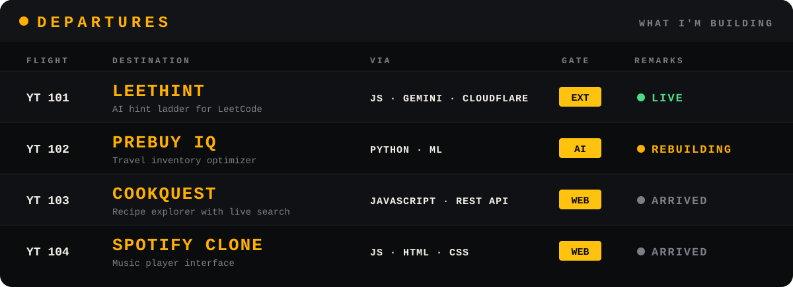
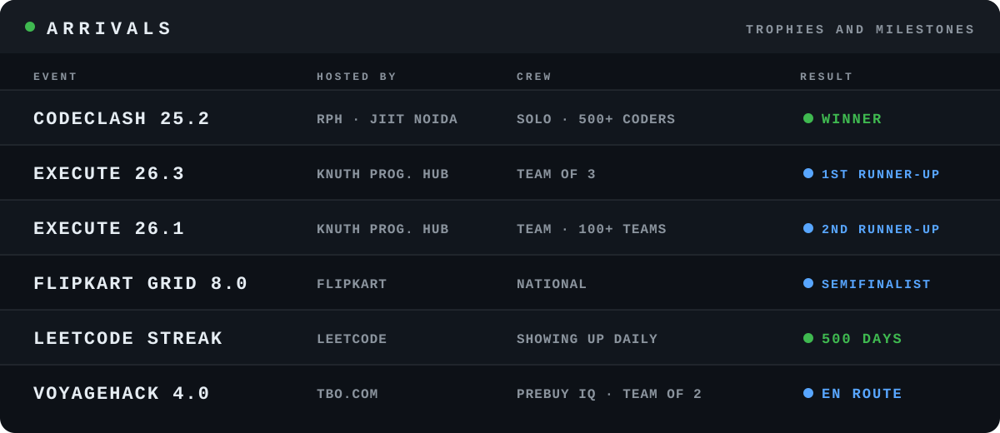
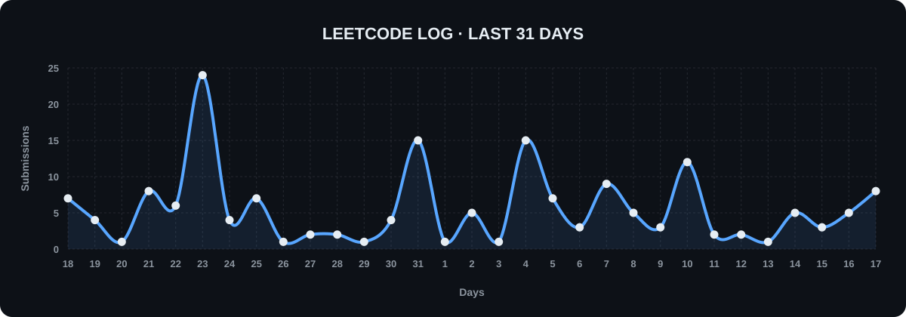

<!-- Departure-board profile for Yug912. Board images live in /assets and are generated by gen.py -->

  

  
  
  

<code>// boarding pass</code> 
B.Tech CSE at <b>JIIT Noida</b> · Technical Lead at <b>Rapid Programming Hub</b> 
LeetCode <b>Knight</b> · Codeforces <b>Specialist</b> (peak 1424) · <b>3★</b> CodeChef · Flipkart GRiD 8.0 semifinalist 
I like problems that won't leave my head until they're solved, whether that's a contest at midnight or a product that has to ship by Sunday.

 

<b>&nbsp;YT 101 · LeetHint</b> — the hint ladder LeetCode never built

 

A browser extension that unlocks hints one rung at a time instead of handing you the answer. It runs on Gemini, with a live backend on Cloudflare, and includes a voice mock interview mode and spaced-repetition revision.

`JavaScript` `Gemini API` `Cloudflare Workers` · <!-- TODO: add LeetHint repo link -->

<b>&nbsp;YT 102 · PreBuy IQ</b> — smarter pre-buying for travel inventory

 

Built for VoyageHack 4.0 by TBO.com. It decides which travel inventory to pre-buy within a budget, and it's now being rebuilt on real datasets.

`Python` `Machine Learning` · <!-- TODO: add PreBuy IQ repo link -->

<b>&nbsp;YT 103 · CookQuest</b> — recipe explorer

 

Search and explore recipes from a live API. · [Board this flight →](https://github.com/Yug912/CookQuest-Recipe-Explorer)

<b>&nbsp;YT 104 · Spotify Clone</b> — music player interface

 

A Spotify-style player built from scratch in plain JavaScript. · [Board this flight →](https://github.com/Yug912/SPOTIFY-CLONE)

 

  

  

  

  

  

  

 

