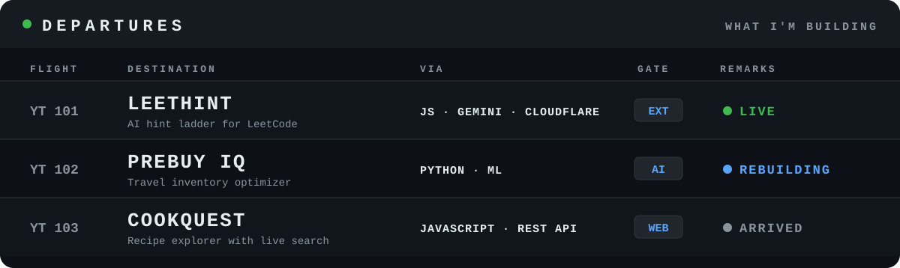
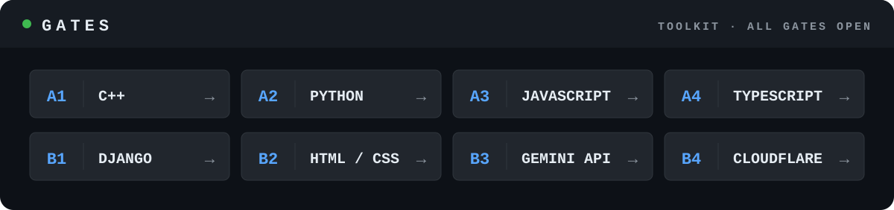
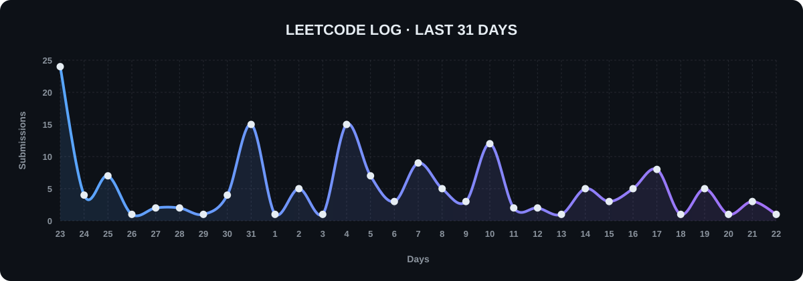

<!-- Departure-board profile for Yug912. Board images live in /board and are generated by gen.py -->

  

  
  
  
  
  

<i>“I like problems that won't leave my head until they're solved — a contest at midnight or a product that has to ship by Sunday.”</i>

 

<b>&nbsp;YT 101 · LeetHint</b> — the hint ladder LeetCode never built

 

A browser extension that unlocks hints one rung at a time instead of handing you the answer. It runs on Gemini, with a live backend on Cloudflare, and includes a voice mock interview mode and spaced-repetition revision.

`JavaScript` `Gemini API` `Cloudflare Workers` · <!-- TODO: add LeetHint repo link -->

<b>&nbsp;YT 102 · Kurukshetra</b> — a bug-hunting simulator for distributed systems

 

Runs a small Docker cluster under a controller that owns the network, injects faults (dropped or delayed messages, partitions, crashes, clock skew) from a single seed, then checks the history for consistency bugs, shrinks failing runs and replays them on a React timeline.

`Go` `Docker` `React` · [Board this flight →](https://github.com/Yug912/Kurukshetra-A-Bug-Hunting-Simulator-for-Distributed-Systems)

<b>&nbsp;YT 103 · CookQuest</b> — recipe explorer

 

Search and explore recipes from a live API. · [Board this flight →](https://github.com/Yug912/CookQuest-Recipe-Explorer)

 

  

  

  

  

  

  

 

